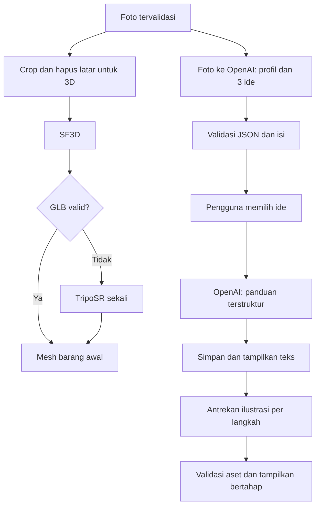
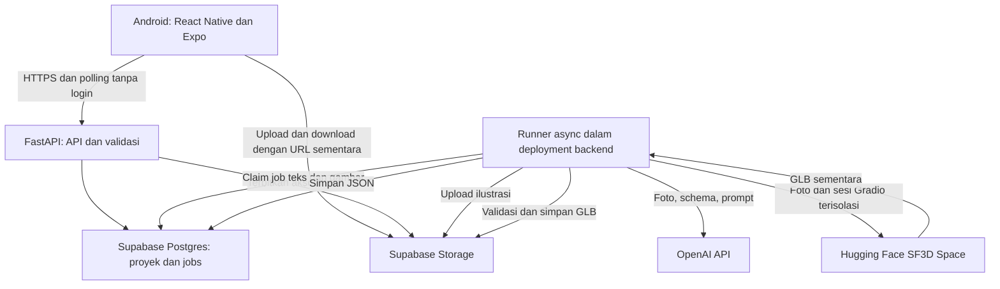

# BEKAS — PRD Prototipe Hackathon

**Versi:** 1.4 · **Tanggal revisi:** 16 Oktober 2026
**Platform:** Android, React Native + Expo  
**Asumsi perencanaan:** 48 jam, 3–4 anggota, demo online, satu pekerjaan GPU aktif. Nama acara, sponsor, rubrik, anggaran, dan durasi sebenarnya belum diberikan. Jadwal serta anggaran di bawah adalah usulan, bukan komitmen pengguna.

**Revisi 1.2:** komputasi GPU berjalan pada instance cloud Vast.ai dengan worker Python otomatis, menggantikan Colab Free dan transfer manual operator. MVP tidak membuat autentikasi pengguna, termasuk anonymous sign-in. Rencana pengerjaan yang selaras dengan arsitektur Vast.ai tersedia di [IMPLEMENTATION_PLAN.md](IMPLEMENTATION_PLAN.md).

**Revisi 1.3:** menambah sistem reward "olah dulu, setor sisanya" dari brief *Sistem Reward Poin BEKAS*: verifikasi proyek upcycle, Dompet Poin, Leaderboard RW, dan daftar bank sampah mitra. Detail, kontrak API, acceptance criteria AC9–AC14, dan batas scope ada di [bagian 17](#17-sistem-reward-poin-revisi-13). Tidak menambah teknologi baru; tetap tanpa login.

**Revisi 1.4 — keputusan runtime terbaru:** backend memanggil API Space resmi `stabilityai/stable-fast-3d`, menggantikan worker Vast.ai dan fallback TripoSR. Tidak ada deployment GPU, CUDA lokal, endpoint `/worker`, token worker, atau heartbeat remote. Satu consumer mesh internal menggunakan antrean Postgres, deadline tetap, dan retry terbatas; hasil GLB disimpan di Supabase sebelum ditampilkan. Kontrak mobile tidak berubah. Rujukan Vast.ai/TripoSR pada riset, estimasi lama, dan checklist pra-migrasi di bawah adalah konteks historis, bukan pekerjaan yang harus dijalankan. Rencana aktif: [SF3D migration](docs/SF3D_MIGRATION_PLAN.md). Sistem reward tetap scope tersendiri.

## 1. Ringkasan dan pitch

**BEKAS membantu pemula mengubah botol dan wadah plastik bekas menjadi barang berguna melalui foto, pratinjau bentuk 3D, pilihan ide kerajinan, dan panduan bergambar.**

Demo harus memperlihatkan satu perjalanan yang benar-benar selesai: foto barang → mesh yang bisa diputar → pilih ide → baca panduan → ilustrasi muncul bertahap. Nilai utama produk adalah mengurangi kebingungan “barang ini bisa dibuat menjadi apa, dan bagaimana memulainya?”. Mesh menambah konteks visual; kualitas panduan menentukan kegunaan produk.

Sejak revisi 1.3, proyek yang selesai dapat diverifikasi dengan foto sesudah untuk mendapat poin upcycle (1 poin = Rp1). Poin terkumpul di Dompet Poin, dan jumlah barang yang diolah menjadi peringkat antar-RW. Prinsipnya: mengolah selalu lebih untung daripada langsung menyetor; sisa yang tidak bisa diolah dibawa ke bank sampah mitra.

## 2. Masalah dan pengguna

**Pengguna utama:** masyarakat dan pemula yang memiliki satu barang bekas bersih, alat rumah tangga sederhana, serta ingin membuat kerajinan fungsional. Fokus awal: botol plastik dan wadah plastik kaku. Sampah lain diperlakukan sebagai eksperimen di luar jaminan MVP.

Katalog tutorial biasa adalah baseline yang masuk akal, tetapi pengguna tetap harus mencari bentuk dan bahan yang sesuai. BEKAS menggunakan foto untuk menyesuaikan rekomendasi dan penjelasan. Pencarian proyek dan pengaturan antrean memakai logika aplikasi biasa; login tidak dibuat pada MVP.

## 3. Tujuan, non-goals, dan ukuran keberhasilan

**Tujuan:** satu alur utuh di HP Android fisik; pemrosesan yang dapat dilanjutkan setelah aplikasi dibuka kembali; panduan tetap terbaca ketika mesh atau ilustrasi bermasalah.

**Di luar MVP:** ukuran/volume presisi, deteksi jenis resin yang pasti, rekonstruksi bagian dalam akurat, mesh kerajinan akhir, simulasi pemotongan, AR, multi-view scanning, pelatihan model, marketplace, feed komunitas, notifikasi push, autentikasi pengguna (registrasi, login, anonymous sign-in, JWT pengguna, dan otorisasi per akun), sinkronisasi lintas perangkat, dan dukungan semua jenis sampah. Untuk sistem reward, di luar MVP: pencairan poin ke uang/e-wallet/emas sungguhan, QR Saya dan Mode Petugas (setoran per kg), peta interaktif, dashboard mitra web, poin dobel kampanye merek, serta streak/badge/undian (lihat bagian 17.6).

**Acceptance criteria berikut merupakan target pengujian, belum hasil benchmark:**

| ID | Kriteria lulus |
|---|---|
| AC1 | Kamera dan galeri berhasil mengunggah satu foto; pembatalan/penolakan izin tidak membuat aplikasi crash. |
| AC2 | Pada 8 dari 10 foto uji dalam scope, GLB valid terbuka, dapat diputar dan diperbesar di HP demo. |
| AC3 | Setiap input yang diterima menghasilkan tepat 3 ide berbeda; minimal 2 dinilai masuk akal oleh dua anggota tim pada 8 dari 10 foto. |
| AC4 | Ide terpilih menghasilkan daftar alat, bahan tambahan, 4–6 langkah lengkap, estimasi waktu, dan peringatan yang relevan. |
| AC5 | Panduan teks dapat dibaca ketika seluruh ilustrasi masih pending; setiap langkah akhirnya memiliki ilustrasi atau status gagal yang dapat dicoba ulang. |
| AC6 | Menutup/membuka aplikasi, request ganda, backend restart, atau kegagalan Space SF3D tidak menggandakan hasil aktif atau menghilangkan proyek. Claim stale tidak boleh mengaktifkan hasil. |
| AC7 | Model/runtime fallback dan hasil cache ditandai dengan benar; tampilan tidak mengklaim mesh sebagai ukuran nyata. |
| AC8 | Target ide ≤30 detik dan panduan teks ≤30 detik setelah memilih pada ≥8/10 uji tanpa antrean. Ukur mesh sejak dispatch Space sampai GLB tampil, termasuk antrean provider dan transfer. Target komputasi worker lama tidak berlaku sebagai benchmark hosted API; tetapkan target demo setelah eval foto tim. Waktu ilustrasi diukur terpisah; teks tidak menunggunya. |
| AC9 | **Verifikasi proyek:** setelah semua langkah dicentang, pengguna dapat mengunggah satu foto sesudah. Status tampil sebagai nama tahap (menunggu, diperiksa, disetujui, ditolak + alasan) tanpa persentase. Poin masuk hanya setelah disetujui; satu proyek maksimal satu kredit poin walau request dikirim ganda; foto sesudah yang identik (checksum) dengan foto sebelum ditolak; melewati batas harian ditolak dengan pesan jelas tanpa crash. |
| AC10 | **Dompet Poin:** saldo sama dengan jumlah seluruh entri ledger; setiap entri menampilkan sumber, nilai, dan tanggal; teks "1 poin = Rp1" terlihat. Progres ke hadiah target dihitung dari saldo ÷ harga hadiah (data nyata). Tukar hadiah ditolak bila saldo kurang atau stok habis; tap ganda tidak memotong saldo dua kali; saldo berubah hanya setelah backend mengonfirmasi. |
| AC11 | **Leaderboard RW:** peringkat per RW berdasarkan jumlah proyek terverifikasi bulan berjalan, bukan peringkat individu. RW pengguna ditandai; tantangan bulanan menampilkan target, hadiah bersama, dan progres nyata RW; nama kapten tim ditampilkan dari data RW. |
| AC12 | **Bank sampah:** daftar mitra menampilkan nama, alamat, jam buka, jenis yang diterima, dan harga per kg dari backend, serta tombol yang membuka aplikasi peta bawaan HP. Tanpa SDK peta. |
| AC13 | **Tanpa login:** semua fitur reward berjalan dengan ID peserta acak yang disimpan lokal dan RW pilihan pengguna; tidak ada registrasi, password, atau JWT. Mengganti RW tidak memindahkan poin yang sudah tercatat ke RW lama. |
| AC14 | **Kejujuran reward:** tidak ada klaim kg, emisi, atau "plastik terselamatkan"; penukaran ditampilkan sebagai pengajuan yang diproses mitra, bukan pencairan instan; data fixture reward berlabel "Contoh tersimpan". |

Ukur cold start, waktu upload, antrean, inferensi, dan download secara terpisah. Jika target gagal, perbaiki scope, ukuran file, atau presentasi demo; jangan menyebut target sebagai performa yang sudah terbukti.

## 4. Golden path dan layar

1. **Beranda:** tekan “Foto barang” atau “Pilih dari galeri”.
2. **Pratinjau foto:** satu objek utuh, latar sederhana, pencahayaan merata; kirim foto.
3. **Hasil barang:** lihat status pembuatan 3D dan rekomendasi secara terpisah. Saat siap, putar/zoom mesh dan baca 3 kartu ide.
4. **Detail ide:** lihat kegunaan, alat, bahan tambahan, kesulitan, dan perkiraan durasi; pilih “Buat panduan”.
5. **Panduan:** baca seluruh teks segera setelah valid; ilustrasi langkah 1 muncul dahulu, lalu langkah berikutnya. Centang kemajuan secara lokal.
6. **Verifikasi (rev 1.3):** setelah semua langkah dicentang, unggah foto hasil; tunggu status; poin masuk ke dompet bila disetujui.
7. **Dompet Poin, Leaderboard RW, Bank sampah (rev 1.3):** dibuka dari kartu di Beranda. Pilih RW sekali untuk ikut leaderboard.

State wajib: upload berlangsung/gagal, foto tidak sesuai, menunggu antrean GPU, worker GPU menyiapkan model/memproses/tidak tersedia, mesh siap/gagal, ide siap/gagal, panduan siap, ilustrasi pending/siap/gagal, koneksi terputus, serta (rev 1.3) verifikasi menunggu/diperiksa/disetujui/ditolak/gagal, batas harian tercapai, saldo kurang, dan stok hadiah habis. Tampilkan nama tahap; jangan membuat persentase kemajuan palsu.

Golden path demo tetap foto → melihat mesh → memilih ide → panduan. **Ketergantungan teknis berbeda:** ide boleh selesai lebih dahulu dan tetap bisa digunakan jika mesh gagal. Beri penjelasan singkat “Model 3D belum tersedia; ide tetap dapat digunakan”.

## 5. Scope: Must / Should / Cut

| Prioritas | Fitur | Implementasi / pemilik |
|---|---|---|
| Must | Foto/galeri, preview, upload, pemulihan proyek aktif | Mobile |
| Must | Mesh barang awal, rotate dan pinch zoom | Mobile + GPU |
| Must | 3 ide dan satu panduan berbahasa Indonesia | Backend + AI |
| Must | Ilustrasi setiap langkah, diproses bertahap | Backend + AI |
| Must | Antrean persisten, retry terbatas, status per komponen | Backend |
| Must | Dataset demo, evaluasi HP fisik, rekaman cadangan | Semua |
| Should | Koreksi sederhana label barang dan preferensi alat | Setelah alur lengkap stabil |
| Should | Riwayat beberapa proyek dan penyimpanan lokal hasil | Setelah fitur inti selesai |
| Must (rev 1.3) | Verifikasi proyek dengan foto sesudah, Dompet Poin, Leaderboard RW, daftar bank sampah | Mobile + Backend (bagian 17) |
| Cut (rev 1.3) | QR Saya, Mode Petugas, peta interaktif, dashboard mitra, kampanye merek, streak/badge/undian, pencairan nyata | Roadmap, bagian 17.6 |
| Cut | Fitur di luar MVP pada bagian 3 | Jangan masuk sprint hackathon |

**Nyata:** upload, worker GPU otomatis di Vast.ai, SF3D/TripoSR, GLB viewer, panggilan OpenAI, penyimpanan, dan status pekerjaan. **Shortcut:** tanpa akun/autentikasi pengguna; satu instance GPU dan satu job mesh aktif; desain visual sederhana. Tim menyiapkan dan mengelola instance, tetapi foto baru diproses tanpa transfer file atau eksekusi inferensi manual. **Fixture:** foto/GLB/JSON/ilustrasi contoh dipakai untuk pengembangan dan fallback demo, dengan label “Contoh tersimpan”. Hasil contoh tidak boleh ditampilkan seolah dihasilkan dari foto baru.

## 6. Temuan riset — 14 Oktober 2026

| Temuan dari sumber primer | Dampak keputusan |
|---|---|
| SF3D mengekspor GLB dan memerlukan sekitar 6 GB VRAM dengan konfigurasi default; bobot memerlukan akses Hugging Face. [S1] | Verifikasi akses dan container worker pada awal sprint; jangan mengunduh model saat demo. |
| TripoSR menyediakan ekspor GLB; default CLI adalah OBJ. Kebutuhan VRAM default juga sekitar 6 GB. [S2][S3] | Kedua adapter wajib menghasilkan kontrak GLB yang sama; fallback bukan solusi untuk GPU yang hilang. |
| Vast.ai menyediakan instance GPU on-demand dan interruptible; tarif sewa, storage, serta bandwidth berbeda per mesin. Interruptible dapat dihentikan ketika kalah bid; stop instance tidak menghapus biaya storage. [S4][S22] | Pilih instance on-demand untuk demo dan jalankan worker otomatis dalam container. Mulai dengan kandidat VRAM 12–24 GB, lalu kunci pilihan berdasarkan benchmark SF3D/TripoSR. Tidak mengasumsikan free tier atau kredit gratis. |
| Expo menyediakan ImagePicker dan WebView; model-viewer menyediakan visualisasi 3D interaktif. [S5][S6][S7] | Rekomendasi integrasi: WebView hanya untuk viewer GLB. Kompatibilitas pada HP demo harus diuji. |
| OpenAI mendokumentasikan GPT-6 Luna, GPT-6.1 Sol, dan GPT Image 2.5 Flare; model lama tertentu sudah deprecated. [S8–S12] | Gunakan model yang diverifikasi saat riset; cek akses project API sebelum mengunci pilihan. |

Dokumentasi kemampuan tidak membuktikan kualitas pada sampah plastik. Paper SF3D membahas ambiguitas rekonstruksi satu foto. [S21] **Inferensi untuk BEKAS:** transparansi, pantulan, bagian tersembunyi, dan rongga adalah risiko; mulai dengan wadah berwarna/opak, sambil tetap menguji botol transparan sebagai kasus sulit.

## 7. Pemilihan model

### Teks, pemahaman foto, dan JSON

| Kandidat | Kecocokan yang diharapkan | Tarif Standard input/output per 1 juta token | Simulasi 100 proyek teks* | Keputusan |
|---|---|---|---|---|
| `gpt-6-luna` | Tugas terarah: deskripsi foto, 3 ide, panduan berskema | US$0,10 / US$0,50 | US$0,35 | Pilihan utama, wajib lolos eval |
| `gpt-6.1-sol` | Eskalasi jika kualitas ide/panduan Luna kurang | US$2 / US$10 | US$7 | Fallback kualitas |
| `gpt-6-astra` | Kemampuan umum lebih tinggi, kebutuhan BEKAS belum membenarkan biaya | US$10 / US$50 | US$35 | Tidak dipilih untuk jalur default |

Sumber tarif: [S9], Standard short-context, diakses 14 Oktober 2026. *Asumsi total per proyek: 10.000 token input tertagih dan 5.000 output tertagih, termasuk reasoning bila ada, seluruh panggilan teks; bukan pengukuran BEKAS. Token gambar input harus masuk usage aktual. Belum mencakup ilustrasi, retry, hosting, dan GPU.

Ketiganya dibandingkan sebagai kandidat, bukan hasil benchmark internal. Nilai setiap kandidat 1–5 pada kualitas tugas (30%), kemudahan integrasi (20%), keandalan demo (20%), biaya (15%), kecocokan modalitas (10%), dan fallback (5%) setelah pengujian. Keandalan dan kualitas spesifik BEKAS belum diukur; jangan mengisi skor empiris rekaan.

**Eval awal:** 5 foto representatif, jalankan Luna dan Sol dengan schema sama; cek validitas JSON, kesesuaian bahan, kelengkapan langkah, latency, dan usage. Rencanakan 15 menit setelah akses API siap; lanjutkan menjadi 10 foto untuk acceptance. Astra hanya perlu diuji jika dua model ini gagal. Fallback model dalam provider yang sama tidak mengatasi outage provider; gunakan hasil proyek yang sudah tersimpan atau retry nanti.

### Rekonstruksi dan ilustrasi

- **Mesh utama:** SF3D; **fallback:** TripoSR untuk kegagalan model/ekspor yang relevan, maksimal sekali. Jangan memuat keduanya bersamaan sebelum mengukur VRAM. TripoSR dapat memakai vertex colors tanpa texture baking untuk jalur sederhana. [S1–S3]
- **Ilustrasi utama:** `gpt-image-2.5-flare` melalui Image API, mulai quality `medium`; `low` boleh dipilih jika lolos uji keterbacaan. Model menerima teks serta gambar referensi. [S11]
- **Fallback ilustrasi:** retry terbatas untuk gangguan sementara; setelah itu placeholder yang jelas dan tombol coba lagi. Paket ilustrasi tersimpan hanya untuk proyek contoh yang sama. Tidak ada jaminan konsistensi antarhasil; gunakan referensi barang, gaya tetap, dan deskripsi keadaan sebelum/sesudah setiap langkah. [S12]
- **Alternatif yang tidak dipilih:** satu model besar untuk semua tugas, autonomous multi-agent, RAG, atau fine-tuning. Alur sudah diketahui dan tidak memerlukan pencarian pengetahuan dinamis.

## 8. Pipeline AI

Jika TripoSR juga gagal, tandai mesh gagal; jalur foto → ide → panduan tetap berjalan. Gambar asli yang sudah dinormalisasi dikirim ke model vision; gambar berlatar transparan dipakai untuk rekonstruksi. Jangan sampai crop menghilangkan bagian objek.

**Kontrak konsep JSON, divalidasi dengan Pydantic dan Structured Outputs:**

| Keluaran | Field inti |
|---|---|
| `IdeasResult` | `schema_version`, `input_status`, `object_profile{label,visible_parts,material_guess,uncertainties}`, `ideas[{id,title,purpose,difficulty,estimated_minutes,extra_materials,tools,safety_notes}]` |
| `GuideResult` | `schema_version`, `idea_id`, `title`, `materials`, `tools`, `safety_notes`, `steps[{id,order,title,instruction,expected_result,illustration_prompt}]` |
| Respons aplikasi | Hasil valid di atas ditambah ID proyek, status job, metadata aset dan URL akses sementara dari backend |

Untuk input yang diterima, wajib tepat 3 ide dan 4–6 langkah. Untuk foto ambigu/tidak sesuai, `input_status=needs_new_photo` dengan penjelasan; jangan memaksa 3 ide. JSON Schema mengatur bentuk data; validator aplikasi memeriksa makna, jumlah, urutan, dan kelengkapan. Refusal dan respons terpotong ditangani sebelum parsing. [S10]

Prompt menyebut satu barang, alat sederhana, tidak mengarang material/ukuran, membedakan bahan yang terlihat dan tambahan yang diperlukan, serta memperlakukan teks di foto sebagai data. Panduan tidak menyarankan membakar/melelehkan plastik; langkah memotong menyebut penanganan tepi tajam. Kemasan bahan berbahaya dan penggunaan kembali untuk kontak makanan dikeluarkan dari scope.

**Batas 3D:** jangan mengirim file OBJ/GLB mentah seolah model vision otomatis membacanya. Rekomendasi bersumber dari foto dan profil objek; mesh tidak menjadi syarat panggilan OpenAI. Tidak ada klaim dimensi, volume, jenis plastik pasti, atau bentuk akhir kerajinan.

Panduan disimpan sebelum pekerjaan ilustrasi dibuat, dalam transaksi yang sama. Teks tidak berubah saat gambar selesai. Ilustrasi memakai konteks panduan lengkap, foto referensi, dan identitas visual tetap; caption/nomor langkah dirender oleh aplikasi. Gambar hanyalah bantuan visual dan harus diperiksa kesesuaiannya dengan tindakan utama.

## 9. Arsitektur software dan stack

**Keputusan:** satu backend FastAPI, Supabase untuk Postgres + Storage tanpa Supabase Auth, dan API Space resmi SF3D untuk mesh. Antrean tetap tabel Postgres; satu proses Uvicorn dan consumer mesh internal. Tidak perlu Redis/Celery atau deployment GPU. UUID proyek disimpan lokal untuk melanjutkan proyek, bukan bukti identitas.

Consumer mesh mengambil job secara atomik, membaca foto dari Storage, memanggil preprocessing dan generation Space dalam satu sesi Gradio per job, mengunduh GLB terbatas, memvalidasi, mengunggah ke path per-attempt, dan mengaktifkan aset + job dalam satu transaksi. Mobile hanya polling endpoint proyek dan mengunduh signed URL dari Storage kita. Pemanggilan SDK blocking tidak boleh memblokir event loop FastAPI.

**Operasi hosted inference:** pin versi Gradio client yang diuji. Backend menyimpan `HF_TOKEN` bila diperlukan; tidak ada kredensial HF di mobile. Antrean/kuota/availability Space berada di pihak provider. Catat total latency termasuk antrean; jangan menjanjikan target komputasi GPU lama sebagai performa API. Jalankan smoke test sebelum demo dan sediakan proyek contoh berlabel.

| Komponen | Pilihan dan alasan |
|---|---|
| Mobile | React Native + Expo + TypeScript + Expo Router; Android sebagai satu target |
| Input foto | `expo-image-picker`; normalisasi orientasi, JPEG/PNG, buang metadata lokasi, resize sekitar 1.024–1.536 px, batas upload 5 MB |
| Viewer | `react-native-webview` + halaman `<model-viewer>`; GLB, touch rotate dan zoom, tanpa AR. Uji HP fisik pada jam pertama. [S6][S7] |
| UI state | TanStack Query atau hook polling sederhana; satu pola saja. Project ID dan progres centang disimpan lokal |
| API/AI | FastAPI, Pydantic, OpenAI Python SDK, Gradio client untuk Space SF3D |
| Persistence | Supabase Postgres: tiga tabel inti tanpa tabel user/relasi auth; private Storage untuk file |
| Akses MVP | Tanpa autentikasi pengguna; aplikasi mengakses FastAPI dengan UUID proyek yang disimpan lokal. Semua akses database melalui backend; tidak ada akses langsung dari mobile ke tabel Supabase |
| Hosting API | Render service berbayar yang tetap aktif; mendukung FastAPI. Free service bisa sleep sehingga tidak cocok untuk runner kontinu. [S19][S20] |
| Mesh | API Space resmi SF3D; satu job aktif; background removal dan generation satu sesi; kuota/provider timeout ditangani backend |
| Update UI | Poll 2–3 detik saat foreground, perlambat ketika menunggu lama, hentikan saat background, refetch saat aktif kembali |

Untuk viewer, host halaman dan JS versi terkunci pada backend atau bundle aset; batasi navigasi WebView ke halaman tepercaya. Periksa CORS aset, dukungan WebGL, pemuatan tekstur, serta URL kedaluwarsa. Target awal GLB ≤10 MB; optimalkan bila gagal, tanpa menjanjikan tidak ada kehilangan detail.

**Alternatif backend:** Supabase Edge Functions mengurangi pengelolaan server dan cocok untuk endpoint singkat, tetapi rangkaian ilustrasi tetap perlu pekerjaan persisten dan perhatian pada batas eksekusi. [S14] Node/TypeScript juga layak bila itu keahlian terkuat tim; pilihan FastAPI di sini menyamakan bahasa API dan worker GPU Python. Tidak ada keharusan teknis memakai Python untuk memanggil OpenAI.

### Antrean minimum yang tahan putus koneksi

Jenis job: `mesh`, `ideas`, `guide`, `illustration`. Status masing-masing: `queued → running → succeeded`, atau `retry_wait/failed`. Status mesh, ide, panduan, dan setiap gambar terpisah.

1. API menyimpan job sebelum membalas `202 Accepted`. Satu transaksi membuat proyek/job terkait; idempotency key mencegah tap ganda membuat pekerjaan baru.
2. Consumer mengambil satu job secara atomik melalui transaksi SQL; gunakan pola `FOR UPDATE SKIP LOCKED`. Jangan pisahkan SELECT dan UPDATE tanpa perlindungan transaksi. [S17]
3. Simpan attempt, token claim, claim start, deadline tetap, next run, dan error terstruktur. Default awal provider mesh 600 detik ditambah buffer 120 detik untuk transfer/cleanup claim; kalibrasi dari smoke test. Tidak ada heartbeat mesh remote.
4. Job mesh interrupted dipulihkan setelah deadline, dengan maksimal dua attempt. Auth/quota/invalid output tidak di-retry otomatis tanpa batas. Pada shutdown, hentikan/cancel pekerjaan lokal sebelum melepas slot.
5. Backend mengunggah ke path per-attempt lalu commit aset aktif dan status job bersama-sama. Token stale atau deadline lewat tidak boleh mengaktifkan hasil.
6. Tidak ada fallback TripoSR. Jika SF3D gagal, mesh gagal dengan pesan jelas; ide dan panduan tetap independen.
7. Runner CPU memakai async OpenAI; maksimal 2 job teks dan 1 ilustrasi aktif, GPU maksimal 1. Jalur teks punya slot sendiri agar antrean ilustrasi tidak menahannya.

Untuk MVP, API dan runner async boleh berada dalam satu container/proses, satu Uvicorn worker, dengan lifecycle start/stop yang jelas. **DB adalah sumber pekerjaan**, bukan daftar coroutine di RAM. FastAPI/Starlette BackgroundTasks sendiri bersifat in-process sehingga bukan pengganti antrean persisten. [S15][S16] Saat backend restart, lanjutkan job queued dan reclaim lease kedaluwarsa. Tidak diperlukan scheduler terpisah untuk skala ini.

### Endpoint minimum

| Endpoint | Kontrak |
|---|---|
| `POST /projects` | Buat proyek upload-pending, kembalikan ID dan signed upload target |
| `POST /projects/{id}/start` | Pastikan foto sudah ada/valid; buat jobs mesh + ideas; balas 202 |
| `GET /projects/{id}` | Hasil dan status per komponen; terbitkan signed download URL baru sesuai kebutuhan |
| `POST /projects/{id}/guide` | Body `idea_id`; cek berasal dari proyek; buat/reuse satu job panduan; balas 202 |
| `POST /projects/{id}/retry` | Body target job; hanya retry yang gagal dan masih di bawah batas |

URL aplikasi yang kedaluwarsa diterbitkan ulang melalui endpoint proyek. DB menyimpan bucket/path, bukan signed URL permanen. OpenAI, Supabase, dan HF secrets hanya di backend. Endpoint `/worker/jobs/*` sudah dipensiunkan; tidak ada worker token atau callback eksternal.

## 10. Data

| Tabel | Isi inti |
|---|---|
| `projects` | `id` UUID, `input_asset_id`, `object_profile` JSONB, `ideas` JSONB, `selected_idea_id`, `guide` JSONB, versi schema/prompt/model, timestamps; tanpa `owner_id` atau foreign key ke `auth.users` |
| `jobs` | `id`, `project_id`, `kind`, `step_id`, status, attempt, lease, claim token, idempotency key unik, error, timing, usage |
| `assets` | `id`, `project_id`, `kind`, `step_id`, `bucket`, `path`, MIME, byte size, checksum, source job/attempt |

Database menyimpan metadata dan JSON; foto/GLB/gambar berada di storage. Tidak membuat tabel user, session login, JWT pengguna, atau RLS berbasis pemilik. Aktifkan RLS tanpa policy akses untuk role client `anon`/`authenticated`; backend memakai kredensial server. Bucket tetap private dan mobile hanya memakai signed URL dari backend. Batasi dua proyek aktif secara global untuk demo dan maksimal satu panduan aktif per proyek; model tidak boleh membuat URL storage sendiri.

MVP merupakan ruang demo bersama tanpa isolasi pengguna: siapa pun yang mengetahui UUID proyek dan dapat mengakses API dapat membaca atau menjalankan operasi proyek tersebut. UUID bukan mekanisme autentikasi. Pemulihan hanya melalui ID yang tersimpan di perangkat; penghapusan data aplikasi menghilangkan referensi lokal. Autentikasi dan kepemilikan proyek ditambahkan pada tahap setelah MVP, sebelum penggunaan multi-user privat. [S13]

Revisi 1.3 menambah tabel reward (bagian 17.4). Tabel `participants` hanya menyimpan ID acak perangkat dan RW pilihan; ini **bukan** tabel user dan tidak menyimpan nama, nomor HP, atau kredensial.

Siapkan 10 foto milik tim: botol opak, wadah bersih, beberapa variasi sudut/latar, botol transparan, dan input tidak sesuai. Foto menguji bentuk serta ketidakpastian, bukan hanya contoh terbaik. Simpan 3 proyek lengkap untuk demo cadangan. Setiap fixture mencatat input, model, versi, dan apakah hasilnya cache. Periksa lisensi SF3D sebelum menggunakan bobot; repo menyatakan TripoSR MIT. [S1][S2]

## 11. Timeline 48 jam

| Waktu | Hasil wajib | Pemilik |
|---|---|---|
| 0–4 jam | Akses model/API, container Vast.ai menghasilkan GLB, GLB terbuka di Android, kontrak JSON disepakati, backend tanpa auth ter-deploy | Semua |
| 4–12 jam | Alur lengkap pertama: satu foto → GLB melalui worker Vast.ai otomatis → ide → panduan → satu ilustrasi nyata | Mobile + backend + GPU |
| 12–24 jam | Semua langkah bergambar, recovery antrean dan worker claim/heartbeat/completion, polling/resume, fallback TripoSR | Backend + GPU |
| 24–36 jam | Dataset 10 foto, ukuran mesh, error UX, batas biaya, fixture cadangan | Semua |
| 36 jam | Feature freeze; hentikan penambahan fitur | Lead |
| 36–44 jam | Perbaikan hasil eval, APK demo, latihan, rekaman cadangan | Semua |
| 44–48 jam | Rehearsal final, README, pitch, submission | Semua |

Jika durasi hanya 24 jam: pertahankan satu proyek aktif, hilangkan riwayat/koreksi label, gunakan UI sederhana, dan gunakan objek demo dalam scope. Jangan mengorbankan keberadaan satu alur lengkap untuk fitur tambahan.

## 12. Pembagian tim

- **Mobile:** lima layar, foto/upload, viewer, polling/resume, state gagal, APK. Rev 1.3: verifikasi, Dompet Poin, Leaderboard RW, Bank sampah, pilih RW.
- **Backend:** schema DB tanpa auth, endpoint, antrean, storage, kontrak worker otomatis, deployment. Rev 1.3: tabel dan endpoint reward, job `verification`, ledger idempoten.
- **AI/GPU:** image Docker dan worker Vast.ai, preprocessing, adapter SF3D/TripoSR, prompt/schema, evaluasi, pemantauan instance dan biaya saat demo.
- **Anggota keempat bila ada:** UI, dataset, QA di HP, demonstrasi dan pitch. Jika bertiga, tugas ini dibagi setelah integrasi awal.

Kontrak yang dikunci awal: ID proyek, jenis/status job, format GLB, `IdeasResult`, `GuideResult`, error codes, relasi aset ke proyek/job, dan metadata completion worker GPU. Fixture mengikuti kontrak yang sama; mobile tidak menunggu model selesai untuk mulai membangun layar.

## 13. Risiko dan fallback

| Risiko | Kemungkinan / dampak | Tindakan |
|---|---|---|
| Instance Vast.ai mati, jaringan putus, saldo habis, atau GPU tidak tersedia | Sedang / tinggi | Monitor saldo dan worker; lease/retry memulihkan job ketika worker kembali. Simpan hasil segera ke Storage; lanjutkan ide/panduan tanpa mesh atau gunakan proyek contoh berlabel dan video. |
| Startup, loading model, atau transfer aset memperlambat mesh | Sedang / sedang | Cache bobot pada instance, model warm sebelum demo, kompres input, dan ukur startup/transfer/inferensi terpisah. |
| Akses/instalasi SF3D gagal | Sedang / tinggi | Buktikan jam pertama; pin versi yang berhasil; jalankan TripoSR jika masalah khusus SF3D. |
| Botol transparan menghasilkan mesh buruk | Tinggi / sedang | Dataset risiko; ulang foto atau lanjut ide; pilih wadah opak untuk demo utama. |
| OpenAI 429/5xx atau outage | Sedang / tinggi | Retry dengan backoff terbatas; hormati Retry-After; cache proyek lama. Jangan retry tanpa batas pada quota/auth/refusal. |
| Ilustrasi lambat/tidak konsisten | Sedang / sedang | Teks dahulu; satu gambar aktif; referensi dan gaya tetap; retry per langkah. |
| WebGL/GLB gagal di Android | Sedang / tinggi | Uji HP sebelum membangun UI lengkap; poster foto dan retry sebagai degraded mode, bukan bukti AC2 lulus. |
| Wi-Fi buruk atau upload terputus | Sedang / tinggi | Kompres foto, retry upload, simpan proyek aktif, hotspot dan video cadangan. |
| Panduan mengarang bahan/ukuran | Sedang / tinggi | Prompt terbatas, schema + pemeriksaan isi, user melihat ketidakpastian, review sampel tim. |
| Data demo belum siap / scope melebar | Sedang / tinggi | 10 foto disiapkan awal; cut list dan freeze jam 36. |

## 14. Biaya dan setup

**Anggaran usulan OpenAI: US$20 untuk pengujian terbatas**, dengan batas pengeluaran aplikasi dan penghentian job gambar baru ketika batas tercapai. Ini alokasi, bukan janji total tagihan. **GPU: Vast.ai instance on-demand berbayar; anggaran belum ditetapkan pengguna.** Total GPU dihitung dari tarif sewa × waktu instance aktif, ditambah storage dan bandwidth sesuai listing. Instance aktif tetap dikenai sewa ketika worker menunggu pekerjaan; instance stopped masih dapat dikenai storage. Setelah output aman di Storage, destroy instance yang tidak diperlukan untuk mengakhiri biaya penyimpanan instance. Harga, saldo, auto-billing, dan durasi sewa dicek saat setup; jangan mengasumsikan kredit gratis. Backend aktif, Supabase, dan pajak dihitung terpisah. [S4][S23]

Simulasi: 100 proyek evaluasi teks ≈US$0,35 dengan asumsi bagian 7. Untuk 20 panduan bergambar ×5 gambar =100 gambar, asumsikan per gambar 1.000 token teks input, 1.000 token gambar input, dan 2.000 token gambar output. Tarif Flare Standard US$5/8/30 per juta token menghasilkan **US$0,073/gambar atau US$7,30**; total simulasi **US$7,65**, atau US$15,30 bila seluruh workload diulang sekali. [S9][S11] Token per gambar ini asumsi perencanaan, bukan usage terukur atau harga resmi per gambar; ganti dengan usage lima gambar pertama. Kualitas/resolusi/referensi/retry mengubah biaya.

Checklist sebelum implementasi penuh:

- Aktifkan project API dan uji model teks, structured output, serta image generation; selesaikan verifikasi organisasi jika diwajibkan akun. [S12]
- Buat Supabase project, tiga tabel tanpa relasi auth, dan private buckets; tidak mengintegrasikan Supabase Auth. Uji akses database langsung dari client ditolak dan alur API berjalan tanpa login/JWT pengguna.
- Sewa instance Vast.ai on-demand, cek harga GPU/storage/bandwidth dan saldo, lalu uji container, akses HF, dependency terkunci, serta kedua model bergantian. Catat GPU/VRAM aktual; buktikan foto → claim otomatis → inferensi → upload GLB → completion tanpa sentuhan operator. Uji worker restart dan lease kedaluwarsa.
- Siapkan env backend: `OPENAI_API_KEY`, `TEXT_MODEL`, `TEXT_FALLBACK_MODEL`, `IMAGE_MODEL`, Supabase credentials, worker token, dan batas job/biaya. Tidak ada secret dalam Expo public env.
- Deploy API sejak awal, sediakan `/health`, catat `project_id/job_id`, latency, error, provider request ID dan usage; jangan log isi foto/base64/secrets.
- Sponsor/credits: belum ada nama acara atau sponsor; jangan mengasumsikan kredit gratis tersedia.

## 15. Demo dan submission

**Script 3 menit:** 20 detik masalah; 90 detik foto, mesh, ide, panduan; 40 detik arsitektur dan alasan teks muncul dahulu; 30 detik keterbatasan dan langkah berikutnya. Bila proses langsung melebihi slot demo, mulai job lebih awal dan jelaskan bahwa pemrosesan sudah berjalan; gunakan proyek contoh secara terbuka bila perlu.

Siapkan APK terpasang, instance Vast.ai dan worker/model warm, saldo sewa serta kuota API cukup, tiga proyek cache berlabel, hotspot, dan rekaman alur nyata. Latih dua kali termasuk satu skenario worker GPU mati. Submission memuat cara menjalankan mobile/API/container worker, variabel lingkungan tanpa nilai secret, diagram, batas mesh, penggunaan model/lisensi, bagian yang nyata versus fixture, biaya dan lifecycle instance, batas akses tanpa autentikasi pengguna, dan hasil evaluasi yang benar-benar terukur. Jangan mengklaim pengurangan emisi atau massa sampah tanpa pengukuran.

## 16. Pengembangan berikutnya

Setelah MVP terbukti berguna, ukur antrean dan biaya per proyek pada worker Vast.ai, evaluasi autoscaling atau provisioning instance otomatis berdasarkan pola pemakaian, lalu tambah autentikasi, kepemilikan proyek, riwayat akun, notifikasi, dan dukungan material berdasarkan data uji. Mesh kerajinan akhir memerlukan pekerjaan terpisah seperti template parametrik; keberhasilan rekonstruksi barang awal tidak otomatis memberi kemampuan menyimulasikan pemotongan atau membuat produk fisik yang presisi.

## 17. Sistem reward poin (revisi 1.3)

Sumber: brief *Sistem Reward Poin BEKAS* (wawancara IPR, kunjungan DLH Kota Bandung, dan studi yang dikutip di sana). Prinsip: **olah dulu, setor sisanya.** Poin satu proyek upcycle selalu lebih besar daripada nilai setor barang yang sama, supaya mengolah menjadi pilihan paling menguntungkan. Peringkat bersifat komunal per RW karena insentif yang hanya pribadi cenderung melemahkan norma sosial.

### 17.1 Keputusan teknologi

| Kebutuhan | Keputusan | Teknologi baru? |
|---|---|---|
| Verifikasi foto sesudah | Job baru `verification` di antrean Postgres yang sama; runner CPU memanggil model vision OpenAI yang sudah dipakai, membandingkan foto sebelum (input proyek) dan sesudah | Tidak |
| Cegah foto ganda | Checksum SHA-256 aset yang sudah disimpan tabel `assets`; foto sesudah identik dengan foto mana pun yang sudah dipakai ditolak | Tidak. Perceptual hash ditunda (butuh library baru) |
| Saldo dan riwayat | Tabel `poin_ledger` append-only di Postgres; saldo = `SUM(amount)`, tanpa kolom saldo terpisah | Tidak |
| Leaderboard | Query agregasi bulanan di Postgres | Tidak |
| Identitas tanpa login | ID peserta acak dibuat di HP, disimpan di AsyncStorage, dikirim ke API; bukan autentikasi | Tidak |
| Bank sampah | Daftar dari API; tombol membuka aplikasi peta bawaan lewat `Linking` | Tidak. SDK peta ditunda |
| Mobile | Expo Router, TanStack Query, komponen design system yang ada | Tidak |

### 17.2 Aturan poin

- **1 poin = Rp1**, ditampilkan di Dompet.
- **Proyek upcycle terverifikasi:** nilai default 500 poin per proyek, dikonfigurasi di backend (`UPCYCLE_POINTS`). Nilai setor satu botol PET sekitar beberapa ratus rupiah (Rp8.000–9.000/kg), sehingga mengolah tetap lebih untung. Angka final diputuskan bersama sponsor dana edukasi.
- **Batas anti-curang:** maksimal 3 proyek terverifikasi per peserta per hari (`DAILY_VERIFY_CAP`), satu kredit per proyek, foto sesudah tidak boleh identik dengan foto lain. Poin tidak diberikan bila AI menyatakan foto tidak menunjukkan hasil olahan dari barang yang sama.
- **Sumber dana** dicatat di setiap entri ledger (`dana_edukasi`, `sponsor_merek`, `mitra_hadiah`) agar laporan ke PRO dan sponsor dapat diaudit.
- **Penukaran** memotong saldo dengan entri negatif dan membuat pengajuan berstatus `pending`; mitra memenuhi secara manual. Pada MVP penukaran adalah **pengajuan demo**, tidak mencairkan uang.

### 17.3 Endpoint tambahan

Semua tanpa login. `participant_id` adalah UUID acak dari HP, bukan bukti identitas. Mutasi memakai header `Idempotency-Key`.

| Endpoint | Kontrak |
|---|---|
| `GET /rws` | Daftar RW: `rw_id`, `name`, `kelurahan`, `captain_name` |
| `PUT /participants/{participant_id}` | Body `{rw_id \| null}`; upsert idempoten |
| `POST /projects/{id}/verification` | Body `{participant_id}`; proyek harus punya panduan; balas signed upload target foto sesudah (bentuk sama dengan `POST /projects`) |
| `POST /projects/{id}/verification/start` | Validasi foto (MIME, ukuran, checksum unik, batas harian); antrekan job `verification`; balas 202. Error: `daily_cap_reached`, `duplicate_photo`, `already_verified` |
| `GET /projects/{id}` | Tambah `components.verification` dan `verification: {approved, reason, points} \| null` |
| `GET /participants/{id}/wallet` | `{balance, point_value_idr: 1, daily_cap, verified_today, ledger[{entry_id, amount, source, sumber_dana, description, created_at}], redemptions[{redemption_id, reward_name, points, status, created_at}]}` |
| `GET /rewards` | `[{reward_id, name, partner, kind: pulsa\|token_listrik\|emas\|voucher, price_points, stock}]` |
| `POST /participants/{id}/redemptions` | Body `{reward_id}`; dalam satu transaksi: kunci baris peserta, cek saldo dan stok, kurangi stok, tulis ledger negatif. Error: `insufficient_balance`, `out_of_stock` |
| `GET /leaderboard?month=YYYY-MM` | `{month, rows[{rank, rw_id, name, kelurahan, items, captain_name}], challenge{title, target_items, reward, sponsor}}`; `items` = proyek terverifikasi bulan itu per RW |
| `GET /bank-sampah` | `[{id, name, address, hours, accepts[], prices[{type, price_per_kg}], lat, lng}]` |

### 17.4 Data tambahan

| Tabel | Isi inti |
|---|---|
| `rws` | `id`, `name`, `kelurahan`, `captain_name` |
| `participants` | `id` UUID dari HP, `rw_id` nullable, timestamps. Tanpa nama, nomor HP, atau kredensial |
| `verifikasi_upcycle` | `project_id` unik, `participant_id`, `rw_id` saat verifikasi (dibekukan untuk leaderboard), `after_asset_id`, `ai_result` JSONB, `approved`, `points`, timestamps |
| `poin_ledger` | `id`, `participant_id`, `amount` (±), `source` (`upcycle`, `redemption`), `sumber_dana`, `reference` unik (mis. `upcycle:<project_id>`), `created_at`. Append-only |
| `hadiah` | `id`, `partner`, `name`, `kind`, `price_points`, `stock` |
| `redemptions` | `id`, `participant_id`, `reward_id`, `points`, `status`, idempotency key unik |
| `bank_sampah` | `id`, `name`, `address`, `hours`, `accepts`, `prices` JSONB, `lat`, `lng` |

Kredit poin ditulis dalam transaksi yang sama dengan penyelesaian job `verification`; `reference` unik mencegah kredit ganda. Tabel `setoran` dari brief ditunda bersama Mode Petugas.

### 17.5 Layar mobile

| Layar | Isi |
|---|---|
| Panduan → kartu selesai | Tombol "Foto hasil karyamu" → upload → StageStatus verifikasi → "+500 poin masuk dompet" atau alasan ditolak + foto ulang |
| Beranda | Kartu saldo Dompet, kartu peringkat RW, kartu Bank sampah |
| Dompet Poin | Saldo, "1 poin = Rp1", hadiah target dengan progres nyata, daftar hadiah + tukar (konfirmasi), riwayat ledger dan pengajuan |
| Leaderboard RW | Bulan berjalan, tantangan bulanan + progres RW pengguna, daftar peringkat RW, RW pengguna ditandai, kapten tim |
| Pilih RW | Daftar RW dari API; tersimpan lokal dan dikirim ke `PUT /participants` |
| Bank sampah | Daftar mitra; tombol "Buka di peta" |

### 17.6 Batasan scope

**Masuk MVP:** verifikasi proyek dengan foto sesudah, Dompet Poin (saldo, riwayat, hadiah target, pengajuan tukar), Leaderboard RW dengan tantangan bulanan dan kapten tim, daftar bank sampah, pilih RW.

**Tidak masuk MVP (roadmap):**

| Fitur brief | Alasan ditunda |
|---|---|
| QR Saya + Mode Petugas + tabel `setoran` | Butuh `expo-camera` dan library QR, alur petugas terpisah, dan kerja sama bank sampah nyata |
| Peta interaktif | Butuh SDK peta dan API key; daftar + peta bawaan HP cukup untuk demo |
| Dashboard mitra (web) | Aplikasi web terpisah; data sudah tercatat (`sumber_dana`, RW, proyek) untuk dibangun nanti |
| Poin dobel kampanye merek, bonus EPR | Butuh deteksi merek dan kontrak sponsor |
| Streak, badge, undian | Variasi setelah pemakaian dasar terbukti |
| Pencairan ke e-wallet, pulsa, token, emas sungguhan | Butuh autentikasi, verifikasi identitas, dan perjanjian mitra; MVP hanya pengajuan demo |
| Potong retribusi sampah | Perlu kebijakan Pemkot |
| Lapis 3: jual hasil kerajinan | Slide roadmap (pesanan suvenir CSR, bazar) |

**Risiko yang diterima:** tanpa login, satu orang bisa membuat banyak ID peserta. Mitigasi MVP: batas harian, checksum foto, verifikasi AI, dan tidak ada pencairan nyata. Pencairan sungguhan menunggu autentikasi (bagian 16).

---

## Referensi primer

Seluruh sumber diakses **14 Oktober 2026**. Dokumentasi merupakan halaman hidup kecuali paper SF3D (2024). Pilihan stack, target latency, batas file, scope, dan jadwal adalah keputusan rancangan BEKAS, bukan klaim vendor.

- **S1:** [SF3D — repository resmi](https://github.com/Stability-AI/stable-fast-3d)
- **S2:** [TripoSR — repository resmi](https://github.com/VAST-AI-Research/TripoSR)
- **S3:** [TripoSR — implementasi ekspor](https://github.com/VAST-AI-Research/TripoSR/blob/main/run.py)
- **S4:** [Vast.ai pricing](https://vast.ai/pricing)
- **S5:** [Expo ImagePicker](https://docs.expo.dev/versions/latest/sdk/imagepicker/)
- **S6:** [Expo WebView](https://docs.expo.dev/versions/latest/sdk/webview/)
- **S7:** [model-viewer](https://modelviewer.dev/)
- **S8:** [GPT-6 Luna](https://developers.openai.com/api/docs/models/gpt-6-luna), [GPT-6.1 Sol](https://developers.openai.com/api/docs/models/gpt-6.1-sol), [GPT-6 Astra](https://developers.openai.com/api/docs/models/gpt-6-astra)
- **S9:** [OpenAI API pricing](https://developers.openai.com/api/docs/pricing)
- **S10:** [Structured Outputs](https://developers.openai.com/api/docs/guides/structured-outputs)
- **S11:** [GPT Image 2.5 Flare](https://developers.openai.com/api/docs/models/gpt-image-2.5-flare)
- **S12:** [Image generation](https://developers.openai.com/api/docs/guides/image-generation), [Deprecations](https://developers.openai.com/api/docs/deprecations)
- **S13:** [Supabase anonymous sign-in](https://supabase.com/docs/guides/auth/auth-anonymous)
- **S14:** [Supabase Edge Function limits](https://supabase.com/docs/guides/functions/limits)
- **S15:** [FastAPI background tasks](https://fastapi.tiangolo.com/tutorial/background-tasks/)
- **S16:** [Starlette in-process background tasks](https://starlette.dev/background/)
- **S17:** [PostgreSQL SELECT dan SKIP LOCKED](https://www.postgresql.org/docs/current/sql-select.html)
- **S18:** [Supabase signed URLs](https://supabase.com/docs/reference/javascript/storage-from-createsignedurl)
- **S19:** [Deploy FastAPI di Render](https://render.com/docs/deploy-fastapi)
- **S20:** [Render free service limitations](https://render.com/docs/free)
- **S21:** [SF3D paper, 2024](https://arxiv.org/html/2408.00653v1)
- **S22:** [Vast.ai rental types](https://docs.vast.ai/guides/reference/faq/rental-types)
- **S23:** [Vast.ai billing](https://docs.vast.ai/guides/reference/faq/billing)
