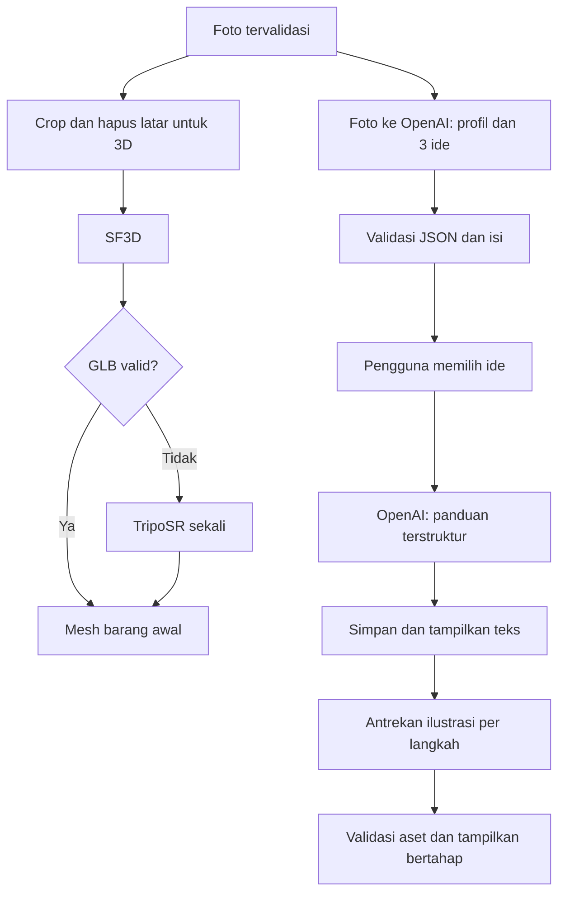
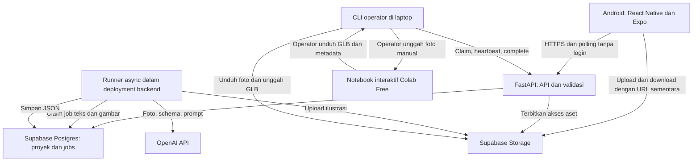

# BEKAS — PRD Prototipe Hackathon

**Versi:** 1.1 · **Tanggal revisi:** 14 Oktober 2026  
**Platform:** Android, React Native + Expo  
**Asumsi perencanaan:** 48 jam, 3–4 anggota, demo online, satu pekerjaan GPU aktif. Nama acara, sponsor, rubrik, anggaran, dan durasi sebenarnya belum diberikan. Jadwal serta anggaran di bawah adalah usulan, bukan komitmen pengguna.

**Revisi 1.1:** notebook GPU memakai Google Colab Free secara interaktif dengan bantuan operator; MVP tidak membuat autentikasi pengguna, termasuk anonymous sign-in. Rencana pengerjaan tersedia di [IMPLEMENTATION_PLAN.md](IMPLEMENTATION_PLAN.md).

## 1. Ringkasan dan pitch

**BEKAS membantu pemula mengubah botol dan wadah plastik bekas menjadi barang berguna melalui foto, pratinjau bentuk 3D, pilihan ide kerajinan, dan panduan bergambar.**

Demo harus memperlihatkan satu perjalanan yang benar-benar selesai: foto barang → mesh yang bisa diputar → pilih ide → baca panduan → ilustrasi muncul bertahap. Nilai utama produk adalah mengurangi kebingungan “barang ini bisa dibuat menjadi apa, dan bagaimana memulainya?”. Mesh menambah konteks visual; kualitas panduan menentukan kegunaan produk.

## 2. Masalah dan pengguna

**Pengguna utama:** masyarakat dan pemula yang memiliki satu barang bekas bersih, alat rumah tangga sederhana, serta ingin membuat kerajinan fungsional. Fokus awal: botol plastik dan wadah plastik kaku. Sampah lain diperlakukan sebagai eksperimen di luar jaminan MVP.

Katalog tutorial biasa adalah baseline yang masuk akal, tetapi pengguna tetap harus mencari bentuk dan bahan yang sesuai. BEKAS menggunakan foto untuk menyesuaikan rekomendasi dan penjelasan. Pencarian proyek dan pengaturan antrean memakai logika aplikasi biasa; login tidak dibuat pada MVP.

## 3. Tujuan, non-goals, dan ukuran keberhasilan

**Tujuan:** satu alur utuh di HP Android fisik; pemrosesan yang dapat dilanjutkan setelah aplikasi dibuka kembali; panduan tetap terbaca ketika mesh atau ilustrasi bermasalah.

**Di luar MVP:** ukuran/volume presisi, deteksi jenis resin yang pasti, rekonstruksi bagian dalam akurat, mesh kerajinan akhir, simulasi pemotongan, AR, multi-view scanning, pelatihan model, marketplace, feed komunitas, notifikasi push, autentikasi pengguna (registrasi, login, anonymous sign-in, JWT pengguna, dan otorisasi per akun), sinkronisasi lintas perangkat, dan dukungan semua jenis sampah.

**Acceptance criteria berikut merupakan target pengujian, belum hasil benchmark:**

| ID | Kriteria lulus |
|---|---|
| AC1 | Kamera dan galeri berhasil mengunggah satu foto; pembatalan/penolakan izin tidak membuat aplikasi crash. |
| AC2 | Pada 8 dari 10 foto uji dalam scope, GLB valid terbuka, dapat diputar dan diperbesar di HP demo. |
| AC3 | Setiap input yang diterima menghasilkan tepat 3 ide berbeda; minimal 2 dinilai masuk akal oleh dua anggota tim pada 8 dari 10 foto. |
| AC4 | Ide terpilih menghasilkan daftar alat, bahan tambahan, 4–6 langkah lengkap, estimasi waktu, dan peringatan yang relevan. |
| AC5 | Panduan teks dapat dibaca ketika seluruh ilustrasi masih pending; setiap langkah akhirnya memiliki ilustrasi atau status gagal yang dapat dicoba ulang. |
| AC6 | Menutup/membuka aplikasi, mengirim request dua kali, dan memutus notebook/CLI atau runner backend tidak menggandakan hasil aktif atau menghilangkan proyek. |
| AC7 | Model/runtime fallback dan hasil cache ditandai dengan benar; tampilan tidak mengklaim mesh sebagai ukuran nyata. |
| AC8 | Target warm run: ide ≤30 detik dan panduan teks ≤30 detik setelah memilih pada ≥8/10 uji tanpa antrean. Target komputasi mesh ≤120 detik sejak sel inferensi dijalankan dengan model siap pada ≥8/10 uji dalam scope; waktu tunggu operator, transfer file, dan impor dicatat terpisah beserta total upload → mesh tampil. Waktu ilustrasi diukur terpisah; teks tidak menunggunya. |

Ukur cold start, waktu upload, antrean, inferensi, dan download secara terpisah. Jika target gagal, perbaiki scope, ukuran file, atau presentasi demo; jangan menyebut target sebagai performa yang sudah terbukti.

## 4. Golden path dan layar

1. **Beranda:** tekan “Foto barang” atau “Pilih dari galeri”.
2. **Pratinjau foto:** satu objek utuh, latar sederhana, pencahayaan merata; kirim foto.
3. **Hasil barang:** lihat status pembuatan 3D dan rekomendasi secara terpisah. Saat siap, putar/zoom mesh dan baca 3 kartu ide.
4. **Detail ide:** lihat kegunaan, alat, bahan tambahan, kesulitan, dan perkiraan durasi; pilih “Buat panduan”.
5. **Panduan:** baca seluruh teks segera setelah valid; ilustrasi langkah 1 muncul dahulu, lalu langkah berikutnya. Centang kemajuan secara lokal.

State wajib: upload berlangsung/gagal, foto tidak sesuai, menunggu operator notebook, GPU memproses/tidak tersedia, mesh siap/gagal, ide siap/gagal, panduan siap, ilustrasi pending/siap/gagal, dan koneksi terputus. Tampilkan nama tahap; jangan membuat persentase kemajuan palsu.

Golden path demo tetap foto → melihat mesh → memilih ide → panduan. **Ketergantungan teknis berbeda:** ide boleh selesai lebih dahulu dan tetap bisa digunakan jika mesh gagal. Beri penjelasan singkat “Model 3D belum tersedia; ide tetap dapat digunakan”.

## 5. Scope: Must / Should / Cut

| Prioritas | Fitur | Implementasi / pemilik |
|---|---|---|
| Must | Foto/galeri, preview, upload, pemulihan proyek aktif | Mobile |
| Must | Mesh barang awal, rotate dan pinch zoom | Mobile + GPU |
| Must | 3 ide dan satu panduan berbahasa Indonesia | Backend + AI |
| Must | Ilustrasi setiap langkah, diproses bertahap | Backend + AI |
| Must | Antrean persisten, retry terbatas, status per komponen | Backend |
| Must | Dataset demo, evaluasi HP fisik, rekaman cadangan | Semua |
| Should | Koreksi sederhana label barang dan preferensi alat | Setelah alur lengkap stabil |
| Should | Riwayat beberapa proyek dan penyimpanan lokal hasil | Setelah fitur inti selesai |
| Cut | Fitur di luar MVP pada bagian 3 | Jangan masuk sprint hackathon |

**Nyata:** upload, SF3D/TripoSR, GLB viewer, panggilan OpenAI, penyimpanan, dan status pekerjaan. **Shortcut:** tanpa akun/autentikasi pengguna; satu notebook GPU gratis dengan transfer input/output oleh operator; desain visual sederhana. Alur GPU belum otomatis end-to-end dan keterlibatan operator dijelaskan saat demo. **Fixture:** foto/GLB/JSON/ilustrasi contoh dipakai untuk pengembangan dan fallback demo, dengan label “Contoh tersimpan”. Hasil contoh tidak boleh ditampilkan seolah dihasilkan dari foto baru.

## 6. Temuan riset — 14 Oktober 2026

| Temuan dari sumber primer | Dampak keputusan |
|---|---|
| SF3D mengekspor GLB dan memerlukan sekitar 6 GB VRAM dengan konfigurasi default; bobot memerlukan akses Hugging Face. [S1] | Verifikasi akses dan notebook pada awal sprint; jangan mengunduh model saat demo. |
| TripoSR menyediakan ekspor GLB; default CLI adalah OBJ. Kebutuhan VRAM default juga sekitar 6 GB. [S2][S3] | Kedua adapter wajib menghasilkan kontrak GLB yang sama; fallback bukan solusi untuk GPU yang hilang. |
| Colab memiliki free tier GPU dengan kuota dinamis dan ketersediaan tidak dijamin. Runtime gratis melarang distributed computing workers dan dapat berhenti sewaktu-waktu. [S4] | Pilih Colab Free untuk inferensi notebook interaktif. Operator menjalankan sel dan memindahkan file; tidak menjalankan daemon antrean, polling backend, atau layanan aplikasi di Colab. |
| Expo menyediakan ImagePicker dan WebView; model-viewer menyediakan visualisasi 3D interaktif. [S5][S6][S7] | Rekomendasi integrasi: WebView hanya untuk viewer GLB. Kompatibilitas pada HP demo harus diuji. |
| OpenAI mendokumentasikan GPT-6 Luna, GPT-6.1 Sol, dan GPT Image 2.5 Flare; model lama tertentu sudah deprecated. [S8–S12] | Gunakan model yang diverifikasi saat riset; cek akses project API sebelum mengunci pilihan. |

Dokumentasi kemampuan tidak membuktikan kualitas pada sampah plastik. Paper SF3D membahas ambiguitas rekonstruksi satu foto. [S21] **Inferensi untuk BEKAS:** transparansi, pantulan, bagian tersembunyi, dan rongga adalah risiko; mulai dengan wadah berwarna/opak, sambil tetap menguji botol transparan sebagai kasus sulit.

## 7. Pemilihan model

### Teks, pemahaman foto, dan JSON

| Kandidat | Kecocokan yang diharapkan | Tarif Standard input/output per 1 juta token | Simulasi 100 proyek teks* | Keputusan |
|---|---|---|---|---|
| `gpt-6-luna` | Tugas terarah: deskripsi foto, 3 ide, panduan berskema | US$0,10 / US$0,50 | US$0,35 | Pilihan utama, wajib lolos eval |
| `gpt-6.1-sol` | Eskalasi jika kualitas ide/panduan Luna kurang | US$2 / US$10 | US$7 | Fallback kualitas |
| `gpt-6-astra` | Kemampuan umum lebih tinggi, kebutuhan BEKAS belum membenarkan biaya | US$10 / US$50 | US$35 | Tidak dipilih untuk jalur default |

Sumber tarif: [S9], Standard short-context, diakses 14 Oktober 2026. *Asumsi total per proyek: 10.000 token input tertagih dan 5.000 output tertagih, termasuk reasoning bila ada, seluruh panggilan teks; bukan pengukuran BEKAS. Token gambar input harus masuk usage aktual. Belum mencakup ilustrasi, retry, hosting, dan GPU.

Ketiganya dibandingkan sebagai kandidat, bukan hasil benchmark internal. Nilai setiap kandidat 1–5 pada kualitas tugas (30%), kemudahan integrasi (20%), keandalan demo (20%), biaya (15%), kecocokan modalitas (10%), dan fallback (5%) setelah pengujian. Keandalan dan kualitas spesifik BEKAS belum diukur; jangan mengisi skor empiris rekaan.

**Eval awal:** 5 foto representatif, jalankan Luna dan Sol dengan schema sama; cek validitas JSON, kesesuaian bahan, kelengkapan langkah, latency, dan usage. Rencanakan 15 menit setelah akses API siap; lanjutkan menjadi 10 foto untuk acceptance. Astra hanya perlu diuji jika dua model ini gagal. Fallback model dalam provider yang sama tidak mengatasi outage provider; gunakan hasil proyek yang sudah tersimpan atau retry nanti.

### Rekonstruksi dan ilustrasi

- **Mesh utama:** SF3D; **fallback:** TripoSR untuk kegagalan model/ekspor yang relevan, maksimal sekali. Jangan memuat keduanya bersamaan sebelum mengukur VRAM. TripoSR dapat memakai vertex colors tanpa texture baking untuk jalur sederhana. [S1–S3]
- **Ilustrasi utama:** `gpt-image-2.5-flare` melalui Image API, mulai quality `medium`; `low` boleh dipilih jika lolos uji keterbacaan. Model menerima teks serta gambar referensi. [S11]
- **Fallback ilustrasi:** retry terbatas untuk gangguan sementara; setelah itu placeholder yang jelas dan tombol coba lagi. Paket ilustrasi tersimpan hanya untuk proyek contoh yang sama. Tidak ada jaminan konsistensi antarhasil; gunakan referensi barang, gaya tetap, dan deskripsi keadaan sebelum/sesudah setiap langkah. [S12]
- **Alternatif yang tidak dipilih:** satu model besar untuk semua tugas, autonomous multi-agent, RAG, atau fine-tuning. Alur sudah diketahui dan tidak memerlukan pencarian pengetahuan dinamis.

## 8. Pipeline AI

Jika TripoSR juga gagal, tandai mesh gagal; jalur foto → ide → panduan tetap berjalan. Gambar asli yang sudah dinormalisasi dikirim ke model vision; gambar berlatar transparan dipakai untuk rekonstruksi. Jangan sampai crop menghilangkan bagian objek.

**Kontrak konsep JSON, divalidasi dengan Pydantic dan Structured Outputs:**

| Keluaran | Field inti |
|---|---|
| `IdeasResult` | `schema_version`, `input_status`, `object_profile{label,visible_parts,material_guess,uncertainties}`, `ideas[{id,title,purpose,difficulty,estimated_minutes,extra_materials,tools,safety_notes}]` |
| `GuideResult` | `schema_version`, `idea_id`, `title`, `materials`, `tools`, `safety_notes`, `steps[{id,order,title,instruction,expected_result,illustration_prompt}]` |
| Respons aplikasi | Hasil valid di atas ditambah ID proyek, status job, metadata aset dan URL akses sementara dari backend |

Untuk input yang diterima, wajib tepat 3 ide dan 4–6 langkah. Untuk foto ambigu/tidak sesuai, `input_status=needs_new_photo` dengan penjelasan; jangan memaksa 3 ide. JSON Schema mengatur bentuk data; validator aplikasi memeriksa makna, jumlah, urutan, dan kelengkapan. Refusal dan respons terpotong ditangani sebelum parsing. [S10]

Prompt menyebut satu barang, alat sederhana, tidak mengarang material/ukuran, membedakan bahan yang terlihat dan tambahan yang diperlukan, serta memperlakukan teks di foto sebagai data. Panduan tidak menyarankan membakar/melelehkan plastik; langkah memotong menyebut penanganan tepi tajam. Kemasan bahan berbahaya dan penggunaan kembali untuk kontak makanan dikeluarkan dari scope.

**Batas 3D:** jangan mengirim file OBJ/GLB mentah seolah model vision otomatis membacanya. Rekomendasi bersumber dari foto dan profil objek; mesh tidak menjadi syarat panggilan OpenAI. Tidak ada klaim dimensi, volume, jenis plastik pasti, atau bentuk akhir kerajinan.

Panduan disimpan sebelum pekerjaan ilustrasi dibuat, dalam transaksi yang sama. Teks tidak berubah saat gambar selesai. Ilustrasi memakai konteks panduan lengkap, foto referensi, dan identitas visual tetap; caption/nomor langkah dirender oleh aplikasi. Gambar hanyalah bantuan visual dan harus diperiksa kesesuaiannya dengan tindakan utama.

## 9. Arsitektur software dan stack

**Keputusan:** satu backend FastAPI, Supabase untuk Postgres + Storage tanpa Supabase Auth, serta notebook GPU Python di Google Colab Free. Antrean berupa tabel Postgres; tidak perlu Redis atau Celery untuk satu GPU dan traffic demo. Endpoint aplikasi tidak memerlukan login atau JWT pengguna. Project ID UUID disimpan lokal untuk melanjutkan proyek, bukan sebagai bukti identitas atau kepemilikan.

CLI operator di laptop menjembatani antrean dengan hasil notebook, memakai endpoint internal `/worker`. Operator memilih job, mengunggah foto ke notebook, menjalankan preprocessing/inferensi, lalu mengunduh dan mengimpor GLB serta metadata. Colab hanya melakukan komputasi interaktif, tidak mengambil pekerjaan backend atau menyediakan endpoint. Aplikasi tidak memanggil notebook secara langsung; notebook tidak perlu public tunnel atau server file. Otomatisasi worker GPU penuh ditunda sampai tersedia runtime yang mendukung pola tersebut.

| Komponen | Pilihan dan alasan |
|---|---|
| Mobile | React Native + Expo + TypeScript + Expo Router; Android sebagai satu target |
| Input foto | `expo-image-picker`; normalisasi orientasi, JPEG/PNG, buang metadata lokasi, resize sekitar 1.024–1.536 px, batas upload 5 MB |
| Viewer | `react-native-webview` + halaman `<model-viewer>`; GLB, touch rotate dan zoom, tanpa AR. Uji HP fisik pada jam pertama. [S6][S7] |
| UI state | TanStack Query atau hook polling sederhana; satu pola saja. Project ID dan progres centang disimpan lokal |
| API/AI | FastAPI, Pydantic, OpenAI Python SDK; satu repo backend dan dua adapter model 3D |
| Persistence | Supabase Postgres: tiga tabel inti tanpa tabel user/relasi auth; private Storage untuk file |
| Akses MVP | Tanpa autentikasi pengguna; aplikasi mengakses FastAPI dengan UUID proyek yang disimpan lokal. Semua akses database melalui backend; tidak ada akses langsung dari mobile ke tabel Supabase |
| Hosting API | Render service berbayar yang tetap aktif; mendukung FastAPI. Free service bisa sleep sehingga tidak cocok untuk runner kontinu. [S19][S20] |
| GPU | Google Colab Free; satu inferensi interaktif sekaligus dengan operator; uji GPU/VRAM aktual dan muat model sebelum demo. Kuota serta sesi tidak dijamin [S4] |
| Update UI | Poll 2–3 detik saat foreground, perlambat ketika menunggu lama, hentikan saat background, refetch saat aktif kembali |

Untuk viewer, host halaman dan JS versi terkunci pada backend atau bundle aset; batasi navigasi WebView ke halaman tepercaya. Periksa CORS aset, dukungan WebGL, pemuatan tekstur, serta URL kedaluwarsa. Target awal GLB ≤10 MB; optimalkan bila gagal, tanpa menjanjikan tidak ada kehilangan detail.

**Alternatif backend:** Supabase Edge Functions mengurangi pengelolaan server dan cocok untuk endpoint singkat, tetapi rangkaian ilustrasi tetap perlu pekerjaan persisten dan perhatian pada batas eksekusi. [S14] Node/TypeScript juga layak bila itu keahlian terkuat tim; pilihan FastAPI di sini menyamakan bahasa API, CLI operator, dan notebook Python. Tidak ada keharusan teknis memakai Python untuk memanggil OpenAI.

### Antrean minimum yang tahan putus koneksi

Jenis job: `mesh`, `ideas`, `guide`, `illustration`. Status masing-masing: `queued → running → succeeded`, atau `retry_wait/failed`. Status mesh, ide, panduan, dan setiap gambar terpisah.

1. API menyimpan job sebelum membalas `202 Accepted`. Satu transaksi membuat proyek/job terkait; idempotency key mencegah tap ganda membuat pekerjaan baru.
2. Consumer mengambil satu job secara atomik melalui transaksi SQL; gunakan pola `FOR UPDATE SKIP LOCKED`. Jangan pisahkan SELECT dan UPDATE tanpa perlindungan transaksi. [S17]
3. Simpan `attempt`, `claim_token`, `lease_expires_at`, `next_run_at`, dan `error_code`. Usulan awal: heartbeat CLI 20 detik, lease 90 detik, timeout komputasi mesh 5 menit, dan batas total claim manual 20 menit; kalibrasi dari uji aktual. Waktu menunggu operator sebelum claim tidak menghabiskan attempt.
4. CLI operator di laptop menjaga heartbeat selama satu pekerjaan manual; tidak mengambil job berikutnya otomatis. CLI berhenti/putus menyebabkan lease kedaluwarsa; backend dapat mengantrekan ulang dalam batas percobaan. CLI melaporkan kegagalan bila notebook putus; batas total claim tetap berlaku meskipun heartbeat aktif.
5. CLI operator atau runner CPU mengunggah file ke path per-attempt, lalu completion memeriksa claim aktif dan keberadaan aset. Commit aset aktif dan status job bersama-sama. Completion dari claim lama tidak boleh menimpa percobaan baru.
6. Jalur SF3D → TripoSR terjadi dalam satu eksekusi notebook; maksimal dua attempt job untuk kegagalan infrastruktur. Hasil notebook menyertakan `job_id`, `attempt`, checksum input, model/version, dan timing; CLI memeriksa kecocokan sebelum impor. Catat fallback agar biaya dan durasi terlihat.
7. Runner CPU memakai async OpenAI; maksimal 2 job teks dan 1 ilustrasi aktif, GPU maksimal 1. Jalur teks punya slot sendiri agar antrean ilustrasi tidak menahannya.

Untuk MVP, API dan runner async boleh berada dalam satu container/proses, satu Uvicorn worker, dengan lifecycle start/stop yang jelas. **DB adalah sumber pekerjaan**, bukan daftar coroutine di RAM. FastAPI/Starlette BackgroundTasks sendiri bersifat in-process sehingga bukan pengganti antrean persisten. [S15][S16] Saat backend restart, lanjutkan job queued dan reclaim lease kedaluwarsa. Tidak diperlukan scheduler terpisah untuk skala ini.

### Endpoint minimum

| Endpoint | Kontrak |
|---|---|
| `POST /projects` | Buat proyek upload-pending, kembalikan ID dan signed upload target |
| `POST /projects/{id}/start` | Pastikan foto sudah ada/valid; buat jobs mesh + ideas; balas 202 |
| `GET /projects/{id}` | Hasil dan status per komponen; terbitkan signed download URL baru sesuai kebutuhan |
| `POST /projects/{id}/guide` | Body `idea_id`; cek berasal dari proyek; buat/reuse satu job panduan; balas 202 |
| `POST /projects/{id}/retry` | Body target job; hanya retry yang gagal dan masih di bawah batas |
| `POST /worker/jobs/claim` | CLI operator dengan token internal; body `job_id` yang ditampilkan aplikasi; claim satu job mesh yang eligible, kembalikan claim token, URL foto dan target upload yang terbatas |
| `POST /worker/jobs/{id}/heartbeat` | Perpanjang lease milik claim yang masih aktif; dapat menerbitkan ulang URL transfer yang kedaluwarsa untuk claim tersebut |
| `POST /worker/jobs/{id}/complete` | Path aset, checksum, model/version, timing; idempoten dan memeriksa claim |
| `POST /worker/jobs/{id}/fail` | Error terstruktur; backend menentukan retry/final failure |

URL aplikasi yang kedaluwarsa diterbitkan ulang melalui endpoint proyek setelah validasi proyek/aset; tanpa pemeriksaan akun pada MVP. Untuk CLI, URL diterbitkan ulang hanya untuk token internal dan claim aktif. DB menyimpan bucket/path, bukan signed URL sebagai identitas permanen. [S18] OpenAI key dan Supabase secret/service key hanya di backend. CLI laptop memakai token worker terbatas; Colab hanya memerlukan Hugging Face read token di notebook secrets bila model memerlukannya. Jangan mencetak secrets. Token internal mengamankan operasi job, bukan sistem login pengguna, dan tidak memberikan akses bebas ke database.

## 10. Data

| Tabel | Isi inti |
|---|---|
| `projects` | `id` UUID, `input_asset_id`, `object_profile` JSONB, `ideas` JSONB, `selected_idea_id`, `guide` JSONB, versi schema/prompt/model, timestamps; tanpa `owner_id` atau foreign key ke `auth.users` |
| `jobs` | `id`, `project_id`, `kind`, `step_id`, status, attempt, lease, claim token, idempotency key unik, error, timing, usage |
| `assets` | `id`, `project_id`, `kind`, `step_id`, `bucket`, `path`, MIME, byte size, checksum, source job/attempt |

Database menyimpan metadata dan JSON; foto/GLB/gambar berada di storage. Tidak membuat tabel user, session login, JWT pengguna, atau RLS berbasis pemilik. Aktifkan RLS tanpa policy akses untuk role client `anon`/`authenticated`; backend memakai kredensial server. Bucket tetap private dan mobile hanya memakai signed URL dari backend. Batasi dua proyek aktif secara global untuk demo dan maksimal satu panduan aktif per proyek; model tidak boleh membuat URL storage sendiri.

MVP merupakan ruang demo bersama tanpa isolasi pengguna: siapa pun yang mengetahui UUID proyek dan dapat mengakses API dapat membaca atau menjalankan operasi proyek tersebut. UUID bukan mekanisme autentikasi. Pemulihan hanya melalui ID yang tersimpan di perangkat; penghapusan data aplikasi menghilangkan referensi lokal. Autentikasi dan kepemilikan proyek ditambahkan pada tahap setelah MVP, sebelum penggunaan multi-user privat. [S13]

Siapkan 10 foto milik tim: botol opak, wadah bersih, beberapa variasi sudut/latar, botol transparan, dan input tidak sesuai. Foto menguji bentuk serta ketidakpastian, bukan hanya contoh terbaik. Simpan 3 proyek lengkap untuk demo cadangan. Setiap fixture mencatat input, model, versi, dan apakah hasilnya cache. Periksa lisensi SF3D sebelum menggunakan bobot; repo menyatakan TripoSR MIT. [S1][S2]

## 11. Timeline 48 jam

| Waktu | Hasil wajib | Pemilik |
|---|---|---|
| 0–4 jam | Akses model/API, Colab Free menghasilkan GLB interaktif, GLB terbuka di Android, kontrak JSON disepakati, backend tanpa auth ter-deploy | Semua |
| 4–12 jam | Alur lengkap pertama: satu foto → GLB melalui CLI/notebook manual → ide → panduan → satu ilustrasi nyata | Mobile + backend + GPU |
| 12–24 jam | Semua langkah bergambar, recovery antrean dan CLI claim/impor, polling/resume, fallback TripoSR | Backend + GPU |
| 24–36 jam | Dataset 10 foto, ukuran mesh, error UX, batas biaya, fixture cadangan | Semua |
| 36 jam | Feature freeze; hentikan penambahan fitur | Lead |
| 36–44 jam | Perbaikan hasil eval, APK demo, latihan, rekaman cadangan | Semua |
| 44–48 jam | Rehearsal final, README, pitch, submission | Semua |

Jika durasi hanya 24 jam: pertahankan satu proyek aktif, hilangkan riwayat/koreksi label, gunakan UI sederhana, dan gunakan objek demo dalam scope. Jangan mengorbankan keberadaan satu alur lengkap untuk fitur tambahan.

## 12. Pembagian tim

- **Mobile:** lima layar, foto/upload, viewer, polling/resume, state gagal, APK.
- **Backend:** schema DB tanpa auth, endpoint, antrean, storage, CLI operator, deployment.
- **AI/GPU:** notebook Colab Free interaktif, preprocessing, adapter SF3D/TripoSR, prompt/schema, evaluasi, operasi notebook saat demo.
- **Anggota keempat bila ada:** UI, dataset, QA di HP, demonstrasi dan pitch. Jika bertiga, tugas ini dibagi setelah integrasi awal.

Kontrak yang dikunci awal: ID proyek, jenis/status job, format GLB, `IdeasResult`, `GuideResult`, error codes, relasi aset ke proyek/job, dan manifest hasil notebook. Fixture mengikuti kontrak yang sama; mobile tidak menunggu model selesai untuk mulai membangun layar.

## 13. Risiko dan fallback

| Risiko | Kemungkinan / dampak | Tindakan |
|---|---|---|
| Colab Free putus, kuota habis, atau GPU tidak tersedia | Tinggi / tinggi | Simpan output segera; operator ulangi notebook jika tersedia, lease/retry menjaga status job; lanjutkan ide/panduan tanpa mesh atau gunakan proyek contoh berlabel dan video. GPU dedicated menjadi opsi tahap berikutnya. |
| Transfer manual memperlambat mesh | Tinggi / sedang | Satu operator khusus, manifest input/output, model warm, ukur waktu operator terpisah; jelaskan bantuan operator saat demo. |
| Akses/instalasi SF3D gagal | Sedang / tinggi | Buktikan jam pertama; pin versi yang berhasil; jalankan TripoSR jika masalah khusus SF3D. |
| Botol transparan menghasilkan mesh buruk | Tinggi / sedang | Dataset risiko; ulang foto atau lanjut ide; pilih wadah opak untuk demo utama. |
| OpenAI 429/5xx atau outage | Sedang / tinggi | Retry dengan backoff terbatas; hormati Retry-After; cache proyek lama. Jangan retry tanpa batas pada quota/auth/refusal. |
| Ilustrasi lambat/tidak konsisten | Sedang / sedang | Teks dahulu; satu gambar aktif; referensi dan gaya tetap; retry per langkah. |
| WebGL/GLB gagal di Android | Sedang / tinggi | Uji HP sebelum membangun UI lengkap; poster foto dan retry sebagai degraded mode, bukan bukti AC2 lulus. |
| Wi-Fi buruk atau upload terputus | Sedang / tinggi | Kompres foto, retry upload, simpan proyek aktif, hotspot dan video cadangan. |
| Panduan mengarang bahan/ukuran | Sedang / tinggi | Prompt terbatas, schema + pemeriksaan isi, user melihat ketidakpastian, review sampel tim. |
| Data demo belum siap / scope melebar | Sedang / tinggi | 10 foto disiapkan awal; cut list dan freeze jam 36. |

## 14. Biaya dan setup

**Anggaran usulan OpenAI: US$20 untuk pengujian terbatas**, dengan batas pengeluaran aplikasi dan penghentian job gambar baru ketika batas tercapai. Ini alokasi, bukan janji total tagihan. **Notebook GPU: Google Colab Free, US$0 dalam batas akses gratis yang tersedia**, tanpa kewajiban langganan atau saldo compute. Backend aktif, storage, dan pajak dihitung terpisah sesuai paket akun; pilihan notebook gratis tidak berarti seluruh stack gratis. Harga/kuota aktual harus dicek saat setup.

Simulasi: 100 proyek evaluasi teks ≈US$0,35 dengan asumsi bagian 7. Untuk 20 panduan bergambar ×5 gambar =100 gambar, asumsikan per gambar 1.000 token teks input, 1.000 token gambar input, dan 2.000 token gambar output. Tarif Flare Standard US$5/8/30 per juta token menghasilkan **US$0,073/gambar atau US$7,30**; total simulasi **US$7,65**, atau US$15,30 bila seluruh workload diulang sekali. [S9][S11] Token per gambar ini asumsi perencanaan, bukan usage terukur atau harga resmi per gambar; ganti dengan usage lima gambar pertama. Kualitas/resolusi/referensi/retry mengubah biaya.

Checklist sebelum implementasi penuh:

- Aktifkan project API dan uji model teks, structured output, serta image generation; selesaikan verifikasi organisasi jika diwajibkan akun. [S12]
- Buat Supabase project, tiga tabel tanpa relasi auth, dan private buckets; tidak mengintegrasikan Supabase Auth. Uji akses database langsung dari client ditolak dan alur API berjalan tanpa login/JWT pengguna.
- Uji Colab Free secara interaktif, akses HF, dependency terkunci, dan kedua model bergantian; catat GPU/VRAM aktual serta batas sesi yang terlihat. Uji transfer foto dan impor GLB melalui CLI laptop.
- Siapkan env backend: `OPENAI_API_KEY`, `TEXT_MODEL`, `TEXT_FALLBACK_MODEL`, `IMAGE_MODEL`, Supabase credentials, worker token, dan batas job/biaya. Tidak ada secret dalam Expo public env.
- Deploy API sejak awal, sediakan `/health`, catat `project_id/job_id`, latency, error, provider request ID dan usage; jangan log isi foto/base64/secrets.
- Sponsor/credits: belum ada nama acara atau sponsor; jangan mengasumsikan kredit gratis tersedia.

## 15. Demo dan submission

**Script 3 menit:** 20 detik masalah; 90 detik foto, mesh, ide, panduan; 40 detik arsitektur dan alasan teks muncul dahulu; 30 detik keterbatasan dan langkah berikutnya. Bila proses langsung melebihi slot demo, mulai job lebih awal dan jelaskan bahwa pemrosesan sudah berjalan; gunakan proyek contoh secara terbuka bila perlu.

Siapkan APK terpasang, notebook/model warm jika GPU tersedia, operator notebook, kuota API cukup, tiga proyek cache berlabel, hotspot, dan rekaman alur nyata. Latih dua kali termasuk satu skenario notebook/CLI mati. Submission memuat cara menjalankan mobile/API/notebook/CLI, variabel lingkungan tanpa nilai secret, diagram, batas mesh, penggunaan model/lisensi, bagian yang nyata versus fixture, keterlibatan operator, batas akses tanpa autentikasi pengguna, dan hasil evaluasi yang benar-benar terukur. Jangan mengklaim pengurangan emisi atau massa sampah tanpa pengukuran.

## 16. Pengembangan berikutnya

Setelah MVP terbukti berguna, otomatisasi worker pada runtime GPU yang mendukung layanan/worker, ukur antrean dan biaya per proyek, lalu tambah autentikasi, kepemilikan proyek, riwayat akun, notifikasi, dan dukungan material berdasarkan data uji. Mesh kerajinan akhir memerlukan pekerjaan terpisah seperti template parametrik; keberhasilan rekonstruksi barang awal tidak otomatis memberi kemampuan menyimulasikan pemotongan atau membuat produk fisik yang presisi.

---

## Referensi primer

Seluruh sumber diakses **14 Oktober 2026**. Dokumentasi merupakan halaman hidup kecuali paper SF3D (2024). Pilihan stack, target latency, batas file, scope, dan jadwal adalah keputusan rancangan BEKAS, bukan klaim vendor.

- **S1:** [SF3D — repository resmi](https://github.com/Stability-AI/stable-fast-3d)
- **S2:** [TripoSR — repository resmi](https://github.com/VAST-AI-Research/TripoSR)
- **S3:** [TripoSR — implementasi ekspor](https://github.com/VAST-AI-Research/TripoSR/blob/main/run.py)
- **S4:** [Google Colab FAQ](https://research.google.com/colaboratory/faq.html)
- **S5:** [Expo ImagePicker](https://docs.expo.dev/versions/latest/sdk/imagepicker/)
- **S6:** [Expo WebView](https://docs.expo.dev/versions/latest/sdk/webview/)
- **S7:** [model-viewer](https://modelviewer.dev/)
- **S8:** [GPT-6 Luna](https://developers.openai.com/api/docs/models/gpt-6-luna), [GPT-6.1 Sol](https://developers.openai.com/api/docs/models/gpt-6.1-sol), [GPT-6 Astra](https://developers.openai.com/api/docs/models/gpt-6-astra)
- **S9:** [OpenAI API pricing](https://developers.openai.com/api/docs/pricing)
- **S10:** [Structured Outputs](https://developers.openai.com/api/docs/guides/structured-outputs)
- **S11:** [GPT Image 2.5 Flare](https://developers.openai.com/api/docs/models/gpt-image-2.5-flare)
- **S12:** [Image generation](https://developers.openai.com/api/docs/guides/image-generation), [Deprecations](https://developers.openai.com/api/docs/deprecations)
- **S13:** [Supabase anonymous sign-in](https://supabase.com/docs/guides/auth/auth-anonymous)
- **S14:** [Supabase Edge Function limits](https://supabase.com/docs/guides/functions/limits)
- **S15:** [FastAPI background tasks](https://fastapi.tiangolo.com/tutorial/background-tasks/)
- **S16:** [Starlette in-process background tasks](https://starlette.dev/background/)
- **S17:** [PostgreSQL SELECT dan SKIP LOCKED](https://www.postgresql.org/docs/current/sql-select.html)
- **S18:** [Supabase signed URLs](https://supabase.com/docs/reference/javascript/storage-from-createsignedurl)
- **S19:** [Deploy FastAPI di Render](https://render.com/docs/deploy-fastapi)
- **S20:** [Render free service limitations](https://render.com/docs/free)
- **S21:** [SF3D paper, 2024](https://arxiv.org/html/2408.00653v1)
