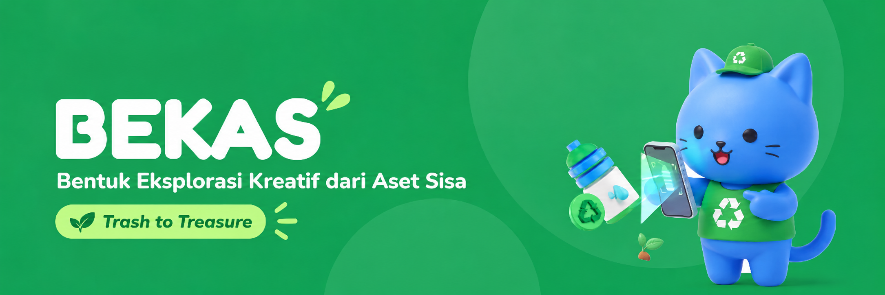

# BEKAS

**Bentuk Eksplorasi Kreatif dari Aset Sisa — Trash to Treasure.**

BEKAS adalah aplikasi Android yang membantu pengguna mengubah sampah menjadi barang berguna. Cukup foto barang, lihat model 3D, pilih dari  ide kerajinan, lalu ikuti panduan bergambar.

## Alur demo

1. Ambil foto atau pilih gambar dari galeri.
2. Lihat pratinjau 3D dan ide kerajinan.
3. Pilih ide, lalu ikuti langkah dengan ilustrasi 2D dan model 3D interaktif.
4. Simpan progres dan lanjutkan proyek kapan saja.


## Setup cepat

### Mobile

Siapkan Node.js LTS, npm, serta Expo Go di Android atau Android emulator. Jalankan dari root repo:

```powershell
cd apps/mobile
Copy-Item .env.example .env
npm install
npm start
```

Biarkan `EXPO_PUBLIC_USE_FIXTURES=true` di `.env` untuk mode demo. Pindai QR dengan Expo Go atau tekan `a` untuk membuka emulator. HP dan komputer harus terhubung ke jaringan yang sama.

### API (opsional, untuk integrasi live)

Siapkan Python 3.12 atau 3.13 dan proyek Supabase. Terapkan [migrasi database](database/README.md) `0001`–`0003`, lalu buat bucket private `bekas-assets`.

Di terminal terpisah, dari root repo:

```powershell
cd services/api
Copy-Item .env.example .env
py -m venv .venv
.\.venv\Scripts\Activate.ps1
python -m pip install -e ".[dev]"
```

Isi kredensial Supabase di `.env`, lalu jalankan satu proses API:

```powershell
uvicorn app.main:app --host 0.0.0.0 --port 8000
```

Health check: `http://localhost:8000/health`. Di `apps/mobile/.env`, ubah `EXPO_PUBLIC_USE_FIXTURES=false` dan isi `EXPO_PUBLIC_API_BASE_URL` dengan IP LAN komputer, misalnya `http://192.168.1.10:8000`. Restart Expo setelah mengubah `.env`.

Kredensial server hanya disimpan di backend. Detail konfigurasi: [panduan API](services/api/README.md).

## Tech stack

- **Mobile:** React Native, Expo, TypeScript, Expo Router.
- **Backend:** FastAPI, PostgreSQL, Supabase Storage.
- **3D Model:** Stable Fast 3D


Detail produk: [PRD](PRD.md) · [Desain](DESIGN.md) · [Status implementasi](docs/AGENT_HANDOFF.md)
